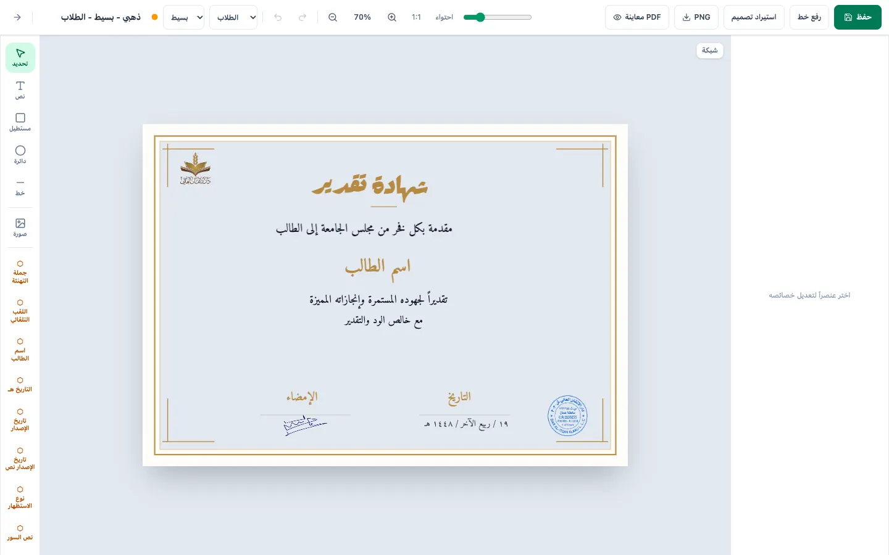
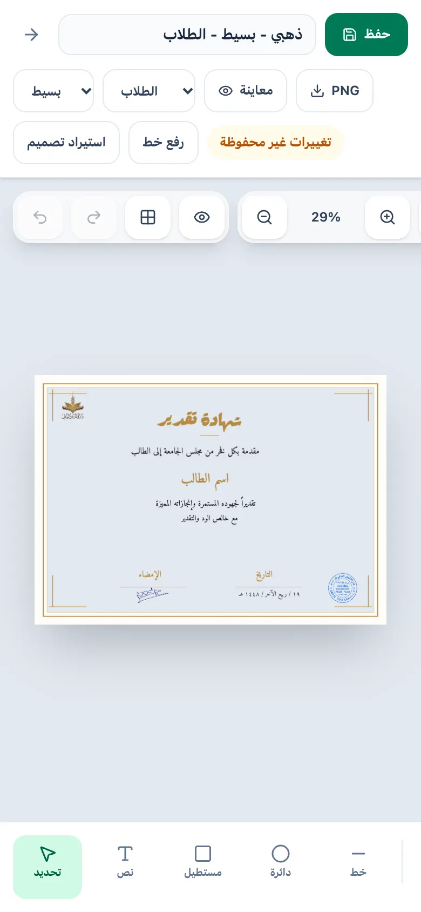
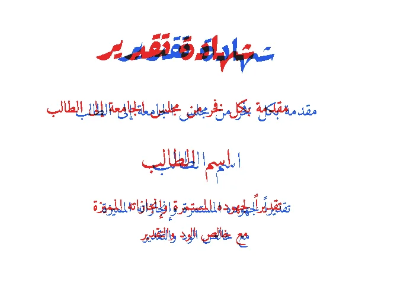
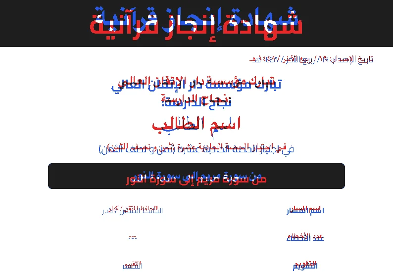

# Certificate Studio: Audit (Phase 0)

Date: 2026-09-30 · Branch: `studio` · Baseline commit: `ba31953`

This audit records the state of the app before the "Canva-quality studio" work, the measured drift between
editor and PDF, and the rendering strategy chosen to remove that drift.

## 1. Current architecture

```
frontend (React 19 + Vite 8 + Tailwind 4)          backend (Express 5, CommonJS)
 ├─ pages/ Dashboard, Generate, GenerateSimple,      ├─ routes/ auth, templates, students,
 │         Students, TemplateNew, TemplateEdit       │          branding, certificates, fonts
 ├─ components/editor/                               ├─ services/pdfService.js  (PDFKit + fontkit)
 │   CanvasEditor.jsx   809 lines: state, history,   ├─ storage/ file | mysql | memory
 │                      shortcuts, zoom/pan, upload,  └─ utils/ templateMetadata, templateVariants,
 │                      save, preview, mobile layout           uploads, authToken, storagePaths
 │   CanvasStage.jsx    661 lines: Konva scene, text
 │                      editing, context menu, grid
 │   PropertiesPanel / ToolsSidebar / TopBar
 │   useHistory.js      snapshot undo (50 steps, elements only)
 └─ utils/templateMetadata.js (hand-kept copy of the backend file)
```

- The editor draws with **Konva** (canvas 2D, so browser shaping). The PDF is drawn separately by **PDFKit**
  (fontkit shaping plus hand-written bidi fixes: numeric-run reversal and bracket mirroring). The two
  renderers share **no layout code**, so they cannot agree except by coincidence.
- Storage: MySQL when any `MYSQL_*` variable is set, otherwise JSON files in `backend/data`. Templates are
  stored as `background_json` and `elements_json` columns in MySQL.
- Auth: an HMAC token lasting 12 h. Every logged-in user is effectively an admin.

## 2. Template JSON model (as found)

```js
{
  id, name, orientation, width, height,          // px; 1123×794 = A4 landscape @96dpi
  background: { type: 'solid'|'image', color, accentColor, imagePath?, customLayout? },
  detailLevel: 'simple'|'detailed', audienceType: 'student'|'adult',
  elements: [{
    id, type: 'text'|'dynamicText'|'image'|'dynamicImage'|'rect'|'circle'|'line',
    x, y, width, height?, rotation, opacity, locked, visible,
    // text:     text, fontFamily, fontSize, fontStyle('normal'|'bold'|'italic'|'bold italic'),
    //           fontWeight (unused), textDecoration, fill, align, lineHeight, letterSpacing, growDirection
    // dynamic:  field, dynamicTextTemplate ('{{value}} … {{recipientTitle}}')
    // shapes:   fill (may be null), stroke, strokeWidth, cornerRadius
    // image:    src (uploads/… path OR base64 data: URL); dynamicImage: field logo|signature|stamp
  }],
  createdAt, updatedAt,
}
```

Problems with the model:
- There is **no `schemaVersion`**, so the model can't be migrated safely.
- `fontFamily` holds a **file basename** (`Cairo-Bold`, `Amiri-Regular`), but some templates use a family name
  (`Cairo`, `Amiri`). The editor then falls back to a system font while the PDF resolves the real font.
- Missing properties mean different things in each renderer. For `rect.fill: null` the editor paints
  `#e2e8f0` and the PDF paints nothing. For `stroke: undefined` the editor paints `#94a3b8` and the PDF paints nothing.
- `fontWeight` (set by the presets) is ignored by both renderers.
- Images uploaded in the editor are stored inline as base64 `data:` URLs, which bloats `templates.json` and
  the MySQL rows.
- The `itqan-template-5-*` color variants are stored as full template copies, which the backend collapses at read time.

## 3. What works

- Login, template CRUD, branding uploads, student CRUD and Excel import, and single-PDF / ZIP generation.
- The JSON-file fallback storage, Hostinger single-app deployment, and background color variants.
- Arabic shaping in the PDF is readable. fontkit applies `rlig`/`calt`, and harakat mostly survive.
- The editor supports select, drag, transform, basic shapes, dynamic fields, font upload and PNG export.
- Backend tests: 6/6 pass (`node --test`).

## 4. What's broken (verified)

| # | Area | Problem |
|---|------|---------|
| 1 | Fidelity | Editor and PDF drift by up to **63 px horizontally and 8 px vertically**, with a mean ink IoU of **0.12** (§6). |
| 2 | Fidelity | The PDF silently **shrinks** any text line wider than its box (down to 72 %). The editor never does, so long names look fine in the editor but print smaller. |
| 3 | Fidelity | `rect.fill: null` shows as grey-blue in the editor but is transparent in the PDF. The gold template's whole inner frame is tinted in the editor. |
| 4 | Fidelity | Font resolution differs. `Cairo`/`Amiri` render in a fallback font in the editor but in the real font in the PDF. |
| 5 | Fidelity | PDFKit ignores `letterSpacing` for Arabic but Konva applies it. PDFKit has a vertical "fudge" of −9 % × size for dynamic text. |
| 6 | Editor | The context menu is **dead code**: nothing sets `menu.visible = true`. |
| 7 | Editor | History records every keystroke in a number field as its own step, keeps 50 steps, and doesn't cover template meta (name, background, size). There is no coalescing. |
| 8 | Editor | Copy, paste and duplicate act only on the first selected element. New ids are `${type}-${Date.now()}`, which can collide. |
| 9 | Editor | Inline text edit rewrites `width` to the longest line on every commit, so editing a wrapped paragraph collapses its box. Enter commits, so you can't type a newline. Dynamic text can't be edited inline. |
| 10 | Editor | There is no autosave, no draft recovery, and no prompt when leaving with unsaved changes. |
| 11 | Editor | Opens at a fixed 70 %, so portrait 1414×2000 templates overflow. There is no fit-on-open on desktop. |
| 12 | Editor | Selecting text adds a green stroke **to the text itself**, which changes the rendering. |
| 13 | Editor | **Uncommitted local change (found in the working tree):** `UploadedImageEl` now wraps `el.src` in `buildAssetUrl()`, which turns `data:` URLs into `http://host/data:…`. Uploaded images disappear. Fixed during the Phase 1 split: `buildAssetUrl` passes `data:`/`blob:` through. |
| 14 | Dashboard | Template thumbnails print raw field keys (`recipientAchievementSentence`, `studentName`). The Generate page preview shows no text at all. |
| 15 | Backend | `routes/fonts.js` lists fonts from a hard-coded `assets/fonts` and ignores `FONTS_DIR`/`PERSISTENT_STORAGE_DIR`, while uploads, `/assets/fonts` and the PDF renderer use `storagePaths.fontsDir`. With persistent storage configured, uploaded fonts never appear in the list and bundled fonts can 404 in the editor. *(fixed in Phase 1: fonts are the union of the bundled and upload directories everywhere)* |
| 16 | Security | Passwords are plaintext. There is no rate limiting, CORS allows `*`, and there is no helmet. Template JSON isn't validated (any body is stored). SVG upload isn't sanitized. |
| 17 | Repo | `backend/node_modules` is **committed** (4,719 files) despite `.gitignore`. `.tmp-venv` (74 MB) and `.tmp-public-html` sit in the root. `test_fonts.pdf`, `تيم1.psd`, sample CSV/XLSX files and `ins.txt` are committed in the root. |
| 18 | Lint | 11 ESLint errors (unused vars, and components created during render in `BrandingPanel`). |
| 19 | Generate | Excel/CSV students imported on the detailed generate page were counted, then **silently dropped**: only the selected saved students were sent. *(fixed in Phase 1)* |
| 20 | API | `POST /api/templates` discarded every field it didn't list, including the `detailLevel` and `audienceType` chosen on the "new template" page. *(fixed in Phase 1)* |
| 21 | PDF | Default signature and stamp fallbacks pointed to `.jpeg` files, but the repo ships `.png`, so they were silently skipped. *(fixed in Phase 1)* |

### UX problems: desktop 1440×900



- The right panel is an empty "select an element" column 256 px wide. There are no document or background
  properties and no layers panel.
- The left rail mixes 5 drawing tools with 16 dynamic-field buttons that wrap onto two lines, so the rail
  has to scroll.
- The top bar has 14 controls at the same visual weight. Font upload and design import sit next to Save.
  The detail and audience selects have no labels.
- There are no snapping guides, marquee selection, alignment tools or hover outlines.
- Portrait templates open cropped (see `audit/desktop-editor-itqan5.webp`).

### UX problems: mobile 390×844



- The top bar wraps onto 3 rows (about 165 px, 20 % of the screen). The floating zoom toolbar overflows the viewport on the right.
- The canvas sits at 29 % in a small area with a lot of dead space. The page scroll container fights
  Konva drags, and there's no pinch zoom or pan.
- Transformer handles are 10 px, far below the 44 px touch minimum.
- The bottom strip scrolls horizontally and hides images and all dynamic fields. There are no bottom sheets.
- The properties panel is a modal that hides the canvas, so edits can't be seen live.
- The dashboard stacks the navigation card above the content, so the first screen is all navigation.

## 5. Gap to "Canva-like"

| Capability | Now | Needed |
|---|---|---|
| Fidelity | Two unrelated renderers | One layout engine, one scene, identical output |
| State | `useState` sprawl in one 809-line component | Single store, command history, autosave |
| Interaction | Drag, resize, single select | Snapping and guides, marquee, groups, align/distribute, context menu, floating toolbar |
| Text | Plain Konva text | Inline `{{chips}}`, auto-fit, curved text, gradient, stroke, shadow |
| Assets | None | Searchable, recolorable Islamic SVG library |
| Mobile | A shrunken desktop layout | Bottom toolbar, sheets, gestures, 44 px handles, keyboard-safe editing |
| Generation | Two pages, synchronous ZIP | Stepper, column mapping, validation, background jobs, many output formats |
| Trust | None | Serial numbers, QR code, `/verify/:serial` |

## 6. Measured editor ↔ PDF drift

Method (scripts are reproducible and will become the visual regression suite):

1. Open the editor in Chrome, hide every Konva node except one text element, and export the stage at
   `pixelRatio = 1/zoom`, so 1 px in the image equals 1 template px.
2. Send the same template, containing only that element on a white page, to `/api/certificates/preview`
   with sample data equal to the editor's placeholders. Rasterize the PDF at 1 pt = 1 px.
3. Compare the ink bounding boxes (Δ of each edge) and the ink IoU.

| Template | Elements | Max \|Δx\| | Max \|Δy\| | Mean IoU | Pixels differing (full page) |
|---|---|---|---|---|---|
| ذهبي مزخرف (`c0574e38…`, 1123×794) | 9 | 49 px | 6 px | 0.08 | 2.6 % |
| شهادة إنجاز قرآنية (`quran-achievement-001`, 794×1123) | 15 | 19 px, and width Δ up to 36 px | 10 px | 0.13 | 3.8 % |
| قالب 5 الطلاب (`itqan-template-5-students`, 1414×2000) | 5 | 63 px | 8 px | 0.15 | 3.0 % |

Totals: 29 elements, median |Δx| = 10 px, median |Δy| = 5 px, and **mean IoU = 0.12**. Glyphs almost never land
on the same pixels.

Overlay (red = editor, blue = PDF, black = both):




Root causes:
- **Horizontal shift at equal width** (for example the gold title Δx = +36 px left and +33 px right). PDFKit centers each line using a
  width that it measures differently from what it draws for Arabic runs.
- **Width Δ** (the Quran template, up to ±36 px) comes from font mismatch (`Cairo` → fallback in the editor) and from the PDF's implicit
  shrink-to-fit.
- **Vertical Δ of 4–8 px on every element** comes from baseline models that disagree. Konva centers the em box in the line box,
  while PDFKit places the ascender at `y` and then applies a hand-tuned −9 % offset.

## 7. Rendering strategy decision

### Options considered

| | (a) HTML scene + headless Chromium | (b) Rasterize the Konva stage | (c) **Shared HarfBuzz layout engine** (chosen) |
|---|---|---|---|
| Arabic shaping and harakat | HarfBuzz (Blink) | Browser | **HarfBuzz (WASM), the same binary on both sides** |
| Identical line breaks | Only if the editor also renders with DOM in Blink. Safari on iOS uses CoreText, so tiny differences are possible | Yes | **Yes, by construction** (one JS line breaker) |
| Vector PDF | Yes | No (bitmap, large files, blurry when zoomed) | **Yes** (glyph outlines as PDF paths, plus an invisible text layer for search and copy) |
| Runs on Hostinger shared Node hosting | **Doubtful.** Chromium needs about 170 MB of binaries plus system libraries (`libnss3`, `libatk`, …) and 150–300 MB of RAM per browser. Shared plans have neither root access nor those libraries | Needs a browser at generation time (client-side only) | **Yes.** Pure JS and WASM, about 1 MB |
| Bulk speed (200 certificates) | About 30–60 s | Tied to the client | **About 2–5 s** (no browser) |
| Curved text, gradient, stroke, shadow | CSS/SVG (curved text is hard) | Canvas | Glyph-level control, so arcs and effects come out the same in both |

### Decision: (c) one text engine, one scene description, two thin painters

```
shared/render/            (isomorphic ESM, no DOM access at import time)
  fonts.js      font registry: file ⇄ family/weight aliases ("Cairo" 700 → Cairo-Bold.ttf)
  textEngine.js HarfBuzz shaping + bidi-js (UAX #9) + greedy line breaking + auto-fit
                → positioned glyph runs, in template px
  scene.js      template + data → display list of ops {rect|ellipse|line|image|glyphs, transform, paint}
frontend  Konva painter: each op becomes a Konva node; text is drawn as cached glyph Path2D in one custom Shape
backend   PDF painter:  each op becomes a PDFKit path/image; text is drawn as vector glyph paths plus invisible text
```

Why this satisfies the non-negotiables:
- **Pixel for pixel.** Line breaking, bidi, shaping, mark positioning, letter spacing and auto-fit all run in
  the *same* JS code on the same font bytes. The editor and the PDF only paint the same display list.
  Paint differences such as anti-aliasing are measured by the visual regression test.
- **Hostinger-safe.** No native binaries and no headless browser. It works on the current deployment unchanged.
- **Fast bulk generation.** Merged, ZIP and PNG outputs come from one pipeline. PNG export can run on the client
  from the same display list.
- **Keeps the stack.** Konva stays the editor renderer. PDFKit stays, but only as a dumb vector writer,
  which its layout differences can no longer affect.

This deliberately ranks (c) above your preferred (a). Option (a) is excellent on a VPS, but it can't be
guaranteed on Hostinger shared hosting, and it would also force the editor away from Konva to DOM rendering.
**If you have (or plan to move to) a Hostinger VPS, tell me.** The `scene.js` display list is engine-agnostic,
so a Chromium painter could be added later without touching templates.

### Migration of existing templates (schemaVersion 1 → 2)

- Every template without `schemaVersion` is treated as v1. `migrateTemplate()` is pure and idempotent, runs
  on read in the backend and the frontend, and never deletes fields.
- Shape defaults follow **what was printed** (the PDF): a missing fill or stroke becomes explicit transparent.
- Text keeps the **editor geometry** (`x`, `y`, `width` are what users arranged). The PDF's implicit shrink becomes
  explicit, `autoFit: { mode: 'shrink', minScale: 0.72 }`, so long names still fit as they did in print, and the
  editor now shows it.
- Family-name fonts (`Cairo`, `Amiri`) resolve through the font registry to the files the PDF already used.
- `fontWeight` (unused) is kept but ignored. `fontStyle` stays the source of truth for bold and italic. Faux bold and
  italic are synthesized identically on both sides when the font has no bold or italic face.

### Proof of concept: results (Phase 1)

Every stored template and every built-in preset (18 in total) is rendered by the new editor and
by the new PDF renderer and compared by `tests/visual/fidelity.spec.js`:

| | v1 (Konva vs PDFKit) | v2 (shared scene) |
|---|---|---|
| Worst text offset | 63 px | **0.021 px** (the search resolution; effectively 0) |
| Median text offset | 10 px | **0.0 px** |
| Text ink amount | fonts differ | **±1.1 %** worst case |
| Full-page pixels differing | 2.6–3.8 % | **0.00–0.10 %** |
| Rendering time, one page | n/a | about 25 ms after warm-up (161 ms cold) |

Same suite against the legacy engine (`PDF_ENGINE=legacy`): 108 failed assertions on one
template, with ink IoU from 0.000 to 0.231.

**Measurement note, and a change from the plan.** The plan targeted "≥ 0.97 thresholded ink IoU". At 1× the
shared scene scored 0.71–0.95 on that metric, even though a sub-pixel search found **zero** offset
(at 1/24 px resolution) and ink totals within 0.5 %. The residue is anti-aliasing: Skia (the canvas)
and pdf.js shade partially covered edge pixels differently, and on 14–28 px text most ink pixels are
edge pixels. The test therefore measures what matters, at print resolution (3×, about 216 dpi):
- **best-fit sub-pixel offset ≤ 0.1 template px**;
- **ink amount within ±3 %**;
- **IoU of ≥ 50 % coverage after a σ = 1 device px blur ≥ 0.95**. The blur cancels AA noise, but
  shifting a render by only ⅓ template px drops its score to ≤ 0.87, so real drift still fails;
- the full page differs on at most 1 % of pixels (pixelmatch, AA-tolerant).

## 8. Phased plan (with adjustments)

See [`ROADMAP.md`](ROADMAP.md) for the checklist. Adjustments to the brief:

1. **Phase 1 adds** the shared render module and the PoC on one template, as the brief asks, but uses strategy (c).
   The PoC exit criterion is a visual regression test between the Konva editor and the rasterized PDF.
   *Result:* it covers all 18 templates and presets, not just one, and they all pass. See the
   metric note above.
2. The **SVG asset library** (Phase 4) and **curved text** (Phase 4) depend on the display list from Phase 1, so no
   extra rendering work is needed later.
3. **Bulk jobs** (Phase 5) use an in-process job queue with jobs persisted in storage (JSON or MySQL), because
   Hostinger has no Redis. The PDF engine is fast enough that 200 certificates take seconds, not minutes.
4. **The repo cleanup** (removing committed `backend/node_modules`) moves to Phase 1, because it pollutes every diff.
   It is non-destructive: `git rm --cached` only, so nothing on disk changes.
5. **TypeScript**: `editor/model` and `editor/store` are written in JS with JSDoc types, checked by Vitest,
   to avoid adding a TS build to the backend and shared code. The conversion can happen later without API changes.
